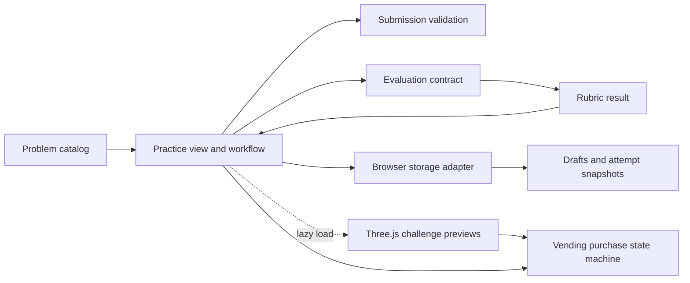

# Architecture

Blueprint is a small browser application with no backend. Its boundaries follow what changes independently: prompt content, the learner's workflow, evaluation policy, and persistence.

`src/app.js` handles rendering, workflow, keyboard controls, and the accessible preview actions. It lazy-loads `src/scene.js` when the preview nears the viewport. The Three.js scene builds lightweight procedural challenge models and pauses when offscreen or reduced motion is enabled. `src/vending.js` is a small purchase state machine shared by the 3D scene and non-WebGL controls. `src/problems.js` owns the problem set. `src/evaluation.js` exports pure validation and evaluation functions. `src/storage.js` isolates browser storage and malformed/unavailable data handling. The `Attempt` record holds the submitted snapshot and review so history does not change when the current form is edited.

The app escapes learner text before injecting rendered markup. The local server binds to loopback by default and sends basic security headers. There are no credentials or server-side user records.

## Evolution seam

For an LLM or human evaluator, add an evaluator implementation behind `evaluate(Attempt) -> Evaluation`. Save the attempt first, then track `submitted → evaluating → completed | failed`. Keep retry/idempotency at the attempt/evaluation boundary. A diagram editor would add a versioned submission payload while leaving problem selection, history, and evaluation result presentation intact.
