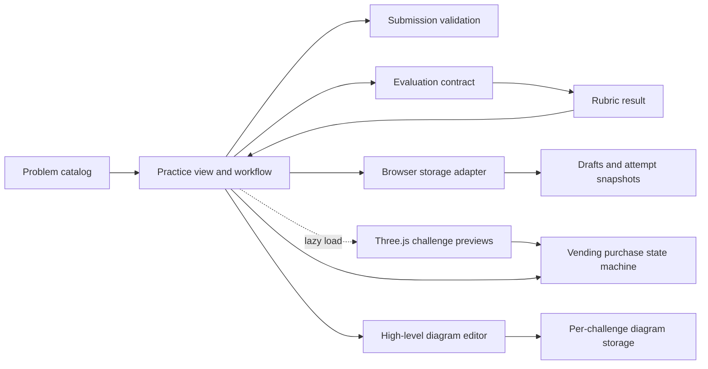

# Architecture

Blueprint is a small browser application with no backend. Its boundaries follow what changes independently: prompt content, the learner's workflow, evaluation policy, and persistence.

`src/app.js` handles rendering, workflow, keyboard controls, the challenge gallery, native-scroll reveals, and accessible preview actions. It lazy-loads `src/scene.js` when the preview nears the viewport. The Three.js scene builds lightweight procedural challenge models and pauses when offscreen or reduced motion is enabled. `src/vending.js` is a purchase state machine shared by the 3D scene and non-WebGL controls. `src/problems.js` owns prompt content and explicit requirement-matching cues. `src/evaluation.js` exports pure validation and section-aware evaluation functions with evidence excerpts. `src/storage.js` isolates browser storage and malformed/unavailable data handling. The `Attempt` record holds the submitted text snapshot, review, and optional `revisionOf` link. Revision focus and key notes live under `revisions` by challenge. `src/hld.js` owns a separate per-challenge SVG diagram model with move/connect/rename/delete/undo/export behavior and its own localStorage key; HLD diagrams are not currently snapshotted into LLD attempts or scored.

The app escapes learner text before injecting rendered markup and SVG labels. The local server binds to loopback by default and sends basic security headers. There are no credentials or server-side user records.

## Evolution seam

For an LLM or human evaluator, add an evaluator implementation behind `evaluate(Attempt) -> Evaluation`. Save the attempt first, then track `submitted → evaluating → completed | failed`. Keep retry/idempotency at the attempt/evaluation boundary. If HLD diagrams become part of evaluated attempts, store a versioned immutable diagram snapshot with each attempt and define evidence-aware diagram feedback before claiming HLD evaluation.
